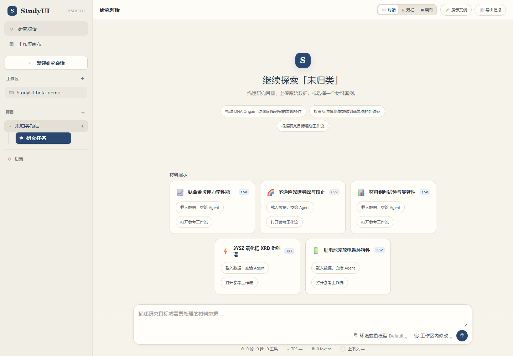
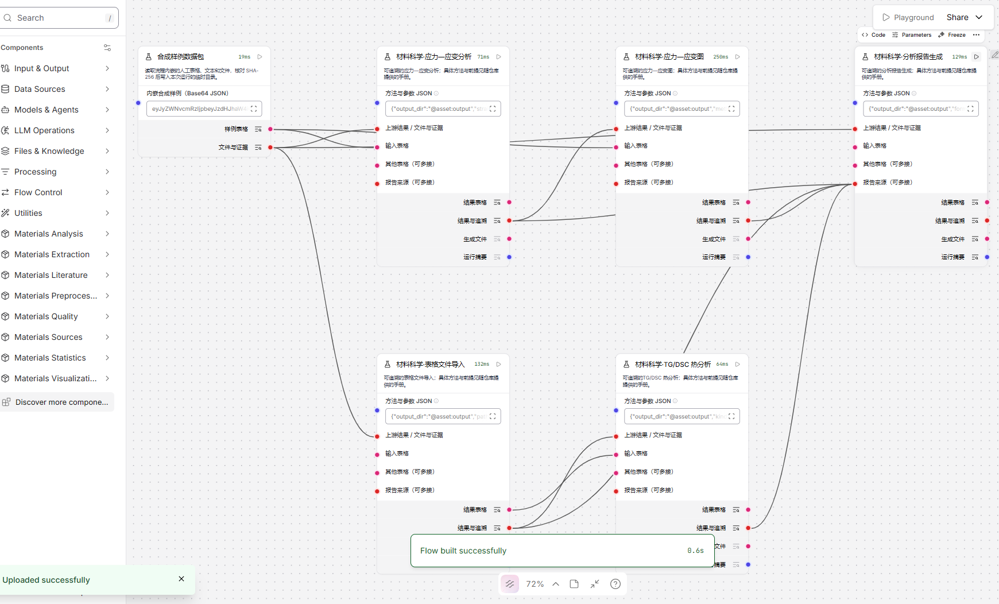
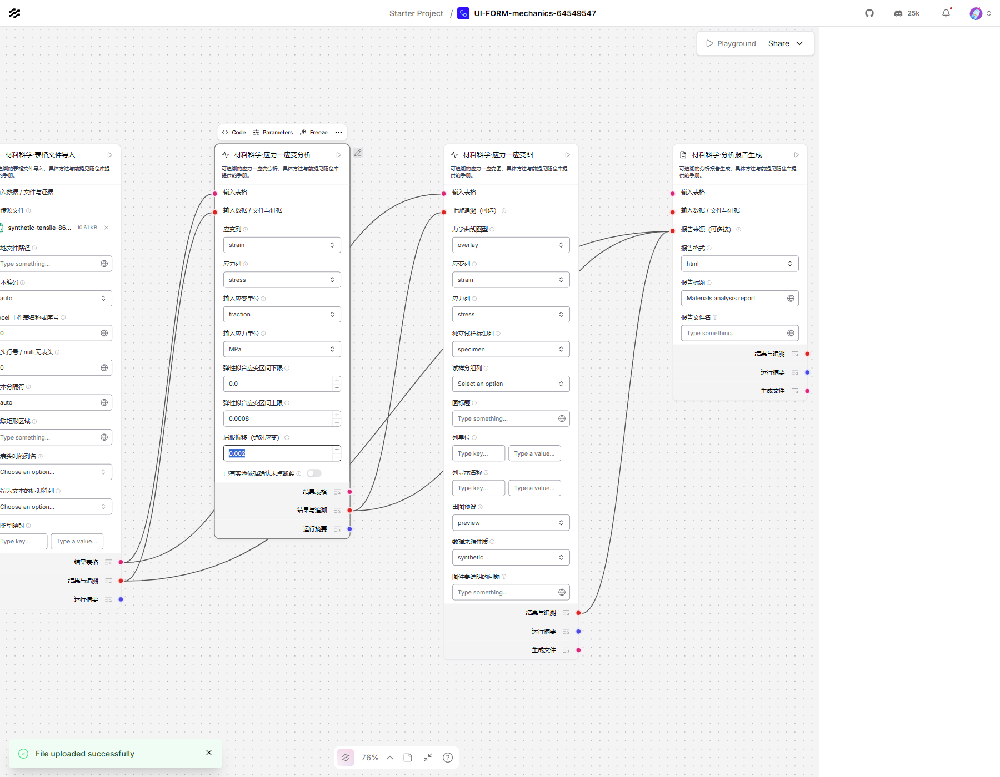
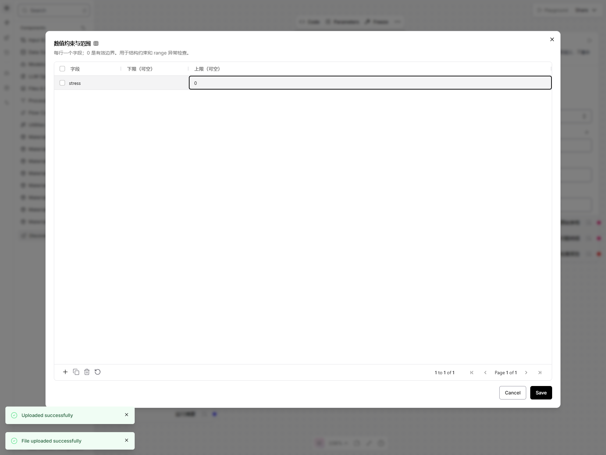
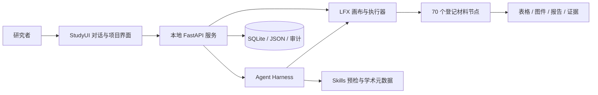

# StudyUI

**面向材料科学研究的本地 Agent 工作台、可视化工作流环境和可追溯科研节点库。**

StudyUI 让研究者用自然语言描述研究目标、检查本地数据、检索学术元数据，并在明确授权后让 Agent 规划、创建、修改和运行科研工作流。对话、工作流画布、科研组件、权限审批和运行审计都在同一个本地服务中完成；模型密钥存入系统凭据库，项目数据保留在本机。

当前发布版：**`beta-demo`**

[下载 Windows x64 免安装便携版](https://github.com/FDUStudyUI/StudyUI/releases/download/beta-demo/StudyUI-beta-demo-windows-x64-portable.zip) · [Release 说明](https://github.com/FDUStudyUI/StudyUI/releases/tag/beta-demo) · [SHA-256](https://github.com/FDUStudyUI/StudyUI/releases/download/beta-demo/StudyUI-beta-demo-windows-x64-portable.zip.sha256)

> **研究结果需要研究者复核。**节点会报告方法、参数、输入来源、警告和适用范围，但不会自动确认样品身份、实验设计、仪器校准或物相。演示数据不能替代真实实验记录。

## 项目简介

StudyUI 由三层组成：

- **StudyUI Agent Harness**：项目会话、持久任务、流式进度、权限档位、一次性审批、调用审计、Skills 预检和受控工具调用。
- **工作流画布与执行器**：基于 Langflow/LFX 的本地画布，保存为可恢复的 JSON 工作流；节点代码来自仓库登记的 StudyUI 组件。
- **材料科学节点库**：覆盖数据接入、提取、预处理、质量检查、材料分析、统计建模、可视化和文献证据的 70 个组件。

它面向“从原始数据到可复核结果”的完整链路：导入仪器或表格数据，检查单位、缺失值、重复和异常，执行确定性科学计算，生成图件与报告，并保留来源、哈希、参数和运行记录。

### 核心能力

- **本地优先**：只监听回环地址；工作流、会话、审批和审计数据保存在项目目录，模型密钥不写入 Git 或工作流 JSON。
- **Agent 可操作画布**：Agent 只能使用组件目录中登记的节点、端口和配置；未知组件或自定义代码不会执行。
- **可追溯运行**：每个节点保留配置、输入来源、警告、结果和附件；工作流修改有历史版本，删除进入可恢复目录。
- **科学计算与语言模型分离**：统计和数值计算由确定性节点完成；AI 分析节点只综合获批的上游数据，不自行联网、读文件或执行代码。
- **无模型也能使用**：首页五个演示案例可打开参考工作流，在表单中调整参数并运行，不需要模型密钥。
- **可审计的权限**：默认“项目协作”，可切换只读、逐项审批和审核后沙箱 Skill；跨项目、删除、权限提升和模型数据外发需要审批。

## 功能展示

### 首页与五个演示案例



首页按项目组织研究对话，并提供钛合金拉伸、多通道光谱、组间比较、3YSZ XRD 和锂电池循环五个演示入口。每个案例区分“载入数据，交给 Agent”和“打开参考工作流”。

### 工作流画布



参考工作流由已登记的导入、分析、绘图和报告节点组成。画布展示真实端口和连线；运行结果可回到会话，并附带表格、图件和报告。

### 原生节点表单



科学节点以原生表单暴露列映射、单位、拟合区间、分组、阈值和输出格式等参数。高级 JSON 仍然可用，但普通使用不要求手写 JSON。

### 质量规则与证据



质量检查节点把规则、发现、严重级别、来源和修复建议分开记录；报告区分数值观察、文献依据和待验证推测。

## 快速开始

### Windows x64 免安装便携版

便携包已内置 Python 3.10.22、全部运行依赖、科研组件、演示数据、示例流程和文档。解压后直接启动，不需要安装 Python、pip 或任何依赖，也不需要执行 `--setup`。

1. 下载 `StudyUI-beta-demo-windows-x64-portable.zip`。
2. 解压到可写目录，进入 `StudyUI-beta-demo/`。
3. 双击 `start_demo.bat`，或在终端运行：

   ```powershell
   .\start_demo.bat
   ```

4. 打开 <http://127.0.0.1:7880>；工作流画布位于 <http://127.0.0.1:7880/canvas/>。

启动器只会在便携目录内创建 `.demo-runtime/` 和 `workflows/`。首次启动不需要联网安装依赖；配置远端模型、在线学术检索或 AI 分析节点调用模型时需要网络。默认端口 `7880`，如被占用可使用 `--port 7886`。

当前免安装包仅提供 **Windows x64**。macOS/Linux 请从源码运行。

### 从源码运行

需要 Python 3.10，首次安装依赖需要联网：

```powershell
git clone https://github.com/FDUStudyUI/StudyUI.git
cd StudyUI
.\start_demo.bat --setup
```

macOS/Linux：

```sh
git clone https://github.com/FDUStudyUI/StudyUI.git
cd StudyUI
sh ./start_demo.sh --setup
```

后续启动省略 `--setup`。环境检查可使用 `--check`，不会安装、启动或修改数据：

```powershell
.\start_demo.bat --check
```

更详细的启动参数、日志位置和故障排除见[安装、运行与排障](docs/demo-launcher.md)。

## 整体架构



Agent 在创建或修改工作流前会检查组件目录、端口、数据类型、项目归属和权限。工作流执行时，节点代码重新绑定到已安装版本，用户参数保留；未知节点、自定义代码和未登记操作不会执行。

## 节点类型与完整清单

节点覆盖 10 个类别，共 **70 个登记组件**。科学计算节点使用操作 key 标识（如 `materials.xrd`）；质量、批量、Skills 等原生组件使用组件类名标识（如 `MaterialUnitCheck`）。

| 类别 | 数量 | 主要能力 |
|---|---:|---|
| 数据接入 | 7 | 表格、文本、PDF、图像、仪器文件、数据库、内置数据包 |
| 内容提取 | 6 | PDF 文本/表格、OCR、图像表格、图表数字化、格式转换 |
| 预处理 | 6 | 筛选、缺失值、单位换算、整形、合并、归一化 |
| 数据质量 | 8 | 模式、缺失、类型、单位、重复、异常和报告汇总 |
| 材料分析 | 8 | XRD、光谱、热分析、力学、SEM/EDS、显微结构、电学 |
| 统计与建模 | 8 | 分组统计、分布、相关、显著性、回归、预测、模型评估 |
| 可视化与导出 | 6 | 科研图、CSV/Excel、HTML/Markdown 报告 |
| 批量处理 | 10 | 多文件、多样品、逐曲线光谱、时序和跨文件比较 |
| 文献与证据 | 8 | 检索、元数据、证据抽取、比较、来源登记 |
| Skills 与 AI | 3 | 科研技能规划/执行、AI 分析子代理 |

<details>
<summary><strong>展开完整节点清单（70 个）</strong></summary>

### 数据接入（7）

表格、文本、PDF、图像、仪器文件、数据库和内置数据包。

| 节点 | 类型标识 |
|---|---|
| 数据库接入 | `io.database_import` |
| 图片文件导入 | `io.image_import` |
| 仪器文件导入 | `io.instrument_import` |
| PDF 文件导入 | `io.pdf_import` |
| 表格文件导入 | `io.table_import` |
| 文本文件导入 | `io.text_import` |
| 内嵌数据包 | `ScienceFixtureBundle` |

### 内容提取（6）

PDF 文本/表格、OCR、图像表格和图表数字化。

| 节点 | 类型标识 |
|---|---|
| 图表数据提取 | `extract.chart_digitize` |
| 文件格式转换 | `extract.convert_file` |
| 图片文字识别 | `extract.image_ocr` |
| 图片表格提取 | `extract.image_tables` |
| PDF 表格提取 | `extract.pdf_tables` |
| PDF 文本提取 | `extract.pdf_text` |

### 预处理（6）

筛选、缺失值、单位、整形、合并和归一化。

| 节点 | 类型标识 |
|---|---|
| 行列筛选 | `preprocess.filter` |
| 多表合并 | `preprocess.merge` |
| 缺失值处理 | `preprocess.missing` |
| 数据归一化 | `preprocess.normalize` |
| 格式转换 | `preprocess.reshape` |
| 单位换算 | `preprocess.units` |

### 数据质量（8）

模式、缺失、类型、单位、重复和异常检查。

| 节点 | 类型标识 |
|---|---|
| 重复记录检查 | `MaterialDuplicateCheck` |
| 缺失检查 | `MaterialMissingCheck` |
| 异常值标记 | `MaterialOutlierCheck` |
| 共享规则与追溯 | `MaterialQualityContext` |
| 检查报告汇总 | `MaterialQualitySummary` |
| 结构检查 | `MaterialSchemaCheck` |
| 类型格式检查 | `MaterialTypeCheck` |
| 单位检查 | `MaterialUnitCheck` |

### 材料分析（8）

XRD、光谱、热分析、力学、SEM/EDS、显微结构和电学。

| 节点 | 类型标识 |
|---|---|
| 分步分析与局部重算 | `materials.analysis_plan` |
| PCA/PLS 化学计量学 | `materials.chemometrics` |
| 应力—应变分析 | `materials.mechanics` |
| 显微结构图像分析 | `materials.microstructure` |
| SEM/EDS 分析 | `materials.sem_eds` |
| FTIR/Raman 数据处理 | `materials.spectra` |
| TG/DSC 热分析 | `materials.thermal` |
| XRD 数据处理 | `materials.xrd` |

### 统计与建模（8）

分组统计、分布、相关、显著性、回归、预测和评估。

| 节点 | 类型标识 |
|---|---|
| 相关性分析 | `stats.correlation` |
| 分布检查 | `stats.distribution` |
| 模型评估 | `stats.evaluate` |
| 分组统计 | `stats.grouped` |
| 多重比较 | `stats.multiple` |
| 预测模型 | `stats.predict` |
| 回归分析 | `stats.regression` |
| 显著性检验 | `stats.significance` |

### 可视化与导出（6）

科研图、CSV/Excel、HTML/Markdown 报告。

| 节点 | 类型标识 |
|---|---|
| 分析报告生成 | `export.report` |
| 结果表导出 | `export.table` |
| 应力—应变图 | `viz.mechanics` |
| 性能对比图 | `viz.performance` |
| 光谱或衍射图 | `viz.spectra` |
| 统计图表 | `viz.statistics` |

### 批量处理（10）

多文件、多样品、光谱曲线、时序和跨文件比较。

| 节点 | 类型标识 |
|---|---|
| 显微图像分析 | `BatchImageAnalyzer` |
| 共享质量检查 | `MaterialBatchQuality` |
| 文件与样品入口 | `MaterialBatchInput` |
| 逐曲线光谱分析 | `BatchSpectrumAnalyzer` |
| 结果汇总 | `MaterialBatchSummary` |
| 电池循环与容量保持率 | `BatteryCycles` |
| 实验组对照研究 | `ContrastStudy` |
| I–V 与光响应分析 | `ElectricalAnalysis` |
| 多模型评估 | `MaterialModelComparison` |
| 时间序列动态分析 | `SeriesDynamics` |

### 文献与证据（8）

检索、元数据、证据抽取、比较和来源登记。

| 节点 | 类型标识 |
|---|---|
| 多篇文献对比 | `lit.compare` |
| 材料与性能信息提取 | `lit.extract` |
| 文献元数据提取 | `lit.metadata` |
| 有依据的方法建议 | `lit.method_recommend` |
| 结果与文献证据 | `lit.result_evidence` |
| 文献搜索 | `lit.search` |
| 引文与来源记录 | `lit.sources` |
| 文献综述摘要 | `lit.summary` |

### Skills 与 AI（3）

科研技能规划/执行和 AI 分析子代理。

| 节点 | 类型标识 |
|---|---|
| AI 分析 | `StudyUIAIAnalysis` |
| 分析执行 | `ResearchSkillExecutor` |
| 任务规划 | `ResearchSkillPlanner` |

</details>

## 五个演示案例

| 案例 | 演示内容 | 重要边界 |
|---|---|---|
| 钛合金拉伸 | 弹性模量和 0.2% 偏移屈服，应力—应变图 | 演示单位和拟合区间不是实验确认 |
| 多通道光谱 | 逐曲线基线、候选峰和分组描述 | 曲线数量不等于独立样品数 |
| 组间比较 | 技术重复聚合后的组间统计 | 合成数据中的显著性不是材料结论 |
| 3YSZ XRD | 仪器头文本导入和候选峰提取 | 无参考谱库时不鉴定物相 |
| 锂电池循环 | 充/放电分支、SOC—电压图和容量核对 | 单循环不能推断寿命或容量保持率 |

完整参数、预期输出和警告见[五个案例操作说明](docs/demo-five-cases.md)。案例输入位于 `demo_datasets/`，包内 `materials_quality/demos/data/` 是逐字节副本；每次读取都校验 SHA-256。

## 配置 AI 模型

在 StudyUI 右上角打开“设置 → 模型管理”，填写配置名称、API 地址、模型名和密钥，保存后可测试连接并切换多个配置。DeepSeek 默认地址为 `https://api.deepseek.com`，模型名可填写 `deepseek-flash`。

密钥保存在 Windows Credential Manager 或系统凭据库，不进入工作流 JSON、会话数据库或 Git。远端 API 必须使用 HTTPS；HTTP 仅允许本机回环服务。主 Agent 需要兼容 OpenAI Chat Completions 工具调用接口。思考等级可选跟随服务默认、关闭、低、高、最高；更高等级可能增加耗时和费用。

模型配置中的“最大输出 token”控制单次回答的生成上限，默认 32,768，不是上下文窗口。不同服务商和模型的实际输出上限不同；设置过高会被服务端拒绝，应先查阅模型说明。

## 数据与安全

- 服务只监听本机回环地址，不是公网服务；画布与 Agent 共用同一端口。
- 会话、任务、审批和调用审计保存在 `.demo-runtime/agent.sqlite3`；非密钥设置和权限在 `.demo-runtime/studyui-settings.json`；Skills 在 `.demo-runtime/skills/`。
- 用户授权后，Agent 可检查明确给出的本地数据路径。连接外部模型时，相关对话上下文会发送到模型服务；经审批的 AI 分析节点还可能发送上游数据。
- 上传文件、生成报告和导出结果位于 `uploads/`、项目目录或 `StudyUI_outputs/`。分享便携目录前应删除这些本机数据。
- 发布到 Git 的内容只包含源代码、测试、文档和经确认的演示数据；虚拟环境、运行数据库、工作流、密钥、日志和本机输出不纳入提交。

## 参考的其他项目

### 上游与同类项目

| 项目 | 关系 |
|---|---|
| [Langflow](https://github.com/langflow-ai/langflow) | 工作流画布和组件运行时；StudyUI 复用其原生表单、端口和 LFX 执行模型。 |
| [LFX](https://pypi.org/project/lfx/) | Langflow 的轻量执行运行时；StudyUI 的工作流执行器和画布依赖它。 |
| [DeepSeek Harness](https://github.com/deepseek-ai/deepseek-harness) | 对话呈现参考：紧凑工具行、逐轮 token 用量、上下文占用和增量渲染；许可见第三方说明。 |

### 核心依赖

| 领域 | 项目 |
|---|---|
| 本地服务与 API | [FastAPI](https://github.com/fastapi/fastapi)、[Uvicorn](https://github.com/encode/uvicorn) |
| 数据与科学计算 | [pandas](https://github.com/pandas-dev/pandas)、[NumPy](https://github.com/numpy/numpy)、[SciPy](https://github.com/scipy/scipy)、[scikit-learn](https://github.com/scikit-learn/scikit-learn)、[statsmodels](https://github.com/statsmodels/statsmodels)、[matplotlib](https://github.com/matplotlib/matplotlib)、[Pint](https://github.com/hgrecco/pint) |
| 文档、图像与 OCR | [PyMuPDF](https://github.com/pymupdf/PyMuPDF)、[pdfplumber](https://github.com/jsvine/pdfplumber)、[RapidOCR](https://github.com/RapidAI/RapidOCR)、[Pillow](https://github.com/python-pillow/Pillow) |
| 前端渲染 | [Markdown-It](https://github.com/markdown-it/markdown-it)、[KaTeX](https://github.com/KaTeX/KaTeX)、[DOMPurify](https://github.com/cure53/DOMPurify) |
| 测试与工程 | [pytest](https://github.com/pytest-dev/pytest)、[Ruff](https://github.com/astral-sh/ruff)、[Playwright](https://github.com/microsoft/playwright) |

学术检索连接到 Crossref、OpenAlex、Semantic Scholar、Europe PMC、DataCite 和 arXiv 的元数据接口；这些服务提供检索数据，不构成对论文全文或实验结论的获取。完整第三方许可见 [`THIRD_PARTY_NOTICES.md`](packages/materials-quality/THIRD_PARTY_NOTICES.md) 和 `agent/ui/assets/vendor/manifest.json`。

## 开发与验证

代码格式、检查命令和生成文件约定见[代码风格指南](docs/code-style.md)。

```powershell
cd packages/materials-quality
python -m venv .venv
.\.venv\Scripts\python.exe -m pip install -e ".[langflow,science,instruments,dev]"
.\.venv\Scripts\python.exe -m pytest -q
```

Linux/macOS 将最后两行替换为 `.venv/bin/python -m pip ...` 和 `.venv/bin/python -m pytest -q`。浏览器回归测试还需要安装 `ui-test` extra 和 Chromium。

重建免安装便携包（Windows，需要本机已验收的 `.demo-venv`）：

```powershell
python scripts/build_portable.py
```

输出位于 `dist/StudyUI-beta-demo-windows-x64-portable.zip`，并生成 `.sha256` 文件。构建源码包使用 `python scripts/build_portable.py --source-only`。

## 项目结构

```text
StudyUI/
├─ start_demo.bat / start_demo.sh       # 启动器
├─ scripts/                             # 启动、便携包构建和验收
├─ docs/                                # 产品、Harness、安全和演示文档
├─ demo_datasets/                       # 五个演示的原始数据
├─ packages/materials-quality/
│  ├─ components/                       # 70 个登记节点
│  ├─ src/materials_quality/
│  │  ├─ agent/                         # Agent、任务、权限、API、UI
│  │  ├─ science/                       # 科学计算与表单适配
│  │  ├─ skills/                        # Skills 规划与执行
│  │  ├─ batch/                         # 批量处理
│  │  └─ demos/                         # 演示清单、数据和参考流程
│  ├─ examples/                         # 可导入示例流程
│  ├─ docs/                             # 节点、方法和验收文档
│  └─ tests/                            # 单元、契约、API 和 UI 回归
└─ README.md
```

## 文档

- [安装、运行与排障](docs/demo-launcher.md)
- [Agent Harness：权限、审批、Skills 与数据边界](docs/agent-harness.md)
- [Agent 可靠性与任务恢复](docs/agent-reliability.md)
- [五个演示案例](docs/demo-five-cases.md)
- [证据引导分析](docs/evidence-guided-analysis.md)
- [材料节点包说明](packages/materials-quality/README.md)
- [科学节点输入输出](packages/materials-quality/docs/science-io.md)
- [科研可靠性指南](packages/materials-quality/docs/research-reliability.md)
- [示例工作流索引](packages/materials-quality/examples/science_flows/README.md)
