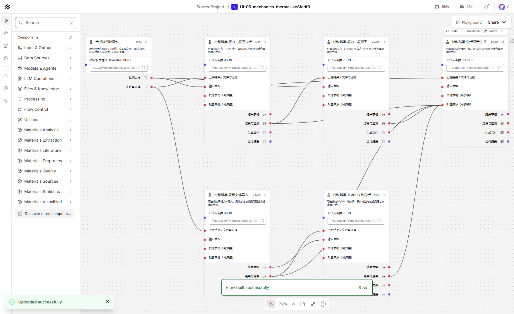

# 全部工作流节点验收

验收目标：Python 3.10，Langflow/LFX 1.13.0；Windows 上使用 Playwright 驱动真实 Microsoft Edge。
这是已实际运行的版本，团队改用其他版本时须重跑验证。

原文的八类 50 项及其子方法已逐项映射到[要求对照表](requirements-matrix.md)。
正式组件共 52 个，包括 50 项功能，以及共享规则和质检报告汇总。新增的 44 个组件经过
原生代码加载器、独立 wheel 安装与组件目录发现验证。

最终全套 **415 项测试通过**（95.96 秒）；7 条提示均为第三方依赖弃用警告。Ruff 检查通过。
独立普通安装环境中的五份原有工作流和 52 节点发现通过；科学工作流同样提供逐图复核命令。

## 工作流和界面

[九份新工作流](../examples/science_flows/README.md)内嵌合成表格、文本、PDF、图片、仪器和数据库文件，
覆盖全部 44 个新增操作及 148 条连接。它们通过 `Graph.dump` 保存，再由 `Graph.from_payload`
重新导入执行；回读 27 个输出文件并复核 11 个源文件哈希。其余子方法有领域参数化测试和方法手册。

九份 JSON 均实际经过网页“导入流程”按钮上传、打开画布、核对节点和连线数、点击最终节点运行，
再使用界面复制输出。九份 HTML 报告全部打开并校验嵌入图片已解码。浏览器未发现页面异常或失败 API 请求。
原有三份材料力学质检工作流也再次通过网页验收：正常 0 项问题、异常 8 项、人工修订后 0 项，
共享规则、来源哈希及错误规则恢复测试均正常。



[机器可读验收记录](full-suite-acceptance.json)保留每张图的节点数、连线数与操作覆盖。
完整本机运行日志和截图在组件包的 `artifacts/`，GitHub Actions 同样上传界面验证产物。

## 已回归的重要边界

样品编号保留前导零及字面值 NA；类型转换拒绝小数截断和布尔真值误判。空样品键不能关联，
缺失时间不能参与插值，歧义时间匹配拒绝输出。单位转换、改名、归一化和导出维护单位元数据；
冲突声明报错。Excel 拒绝不能精确保存的超长数值整数，CSV 可保留其精度。

热分析使用局部事件与明确平台依据，断裂标记需要布尔确认。模型按训练集拟合预处理，
保存后检查校验和与类型白名单。文献数值、单位及来源片段必须一致。JSON Schema 不联网加载外部引用，
HTTP 跳转不跨站发送凭据。缓存同时绑定表格类型、类别顺序、单位、来源及显式输入文件内容；
普通文献或表格中的路径文本不触发文件读取。汇总报告包含前 100 行结果及明确的总行数和截断标记，
完整表格仍由结果表格端口或导出文件提供。

## 复核命令

```powershell
python -m pytest -q
python -m scripts.build_science_examples --verify-only
python -m build --wheel
python -m scripts.verify_install --require-wheel
python -m scripts.ui_acceptance --base-url http://127.0.0.1:7867
python -m scripts.ui_science_acceptance --base-url http://127.0.0.1:7867
```

`--require-wheel` 须在已经普通安装 wheel 的环境运行；开发环境可去掉该选项。
界面验证须先启动隔离的本机 Langflow。外部参考谱库、空间标尺、仪器转换器和在线模型凭据仍须按
具体任务提供，方法不会捏造这些输入。所有示例都是教学合成数据，其拟合精度不代表真实实验表现。
