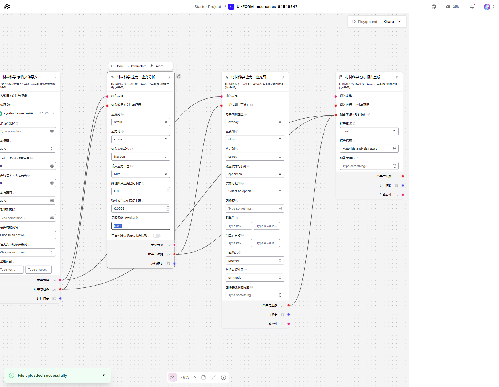
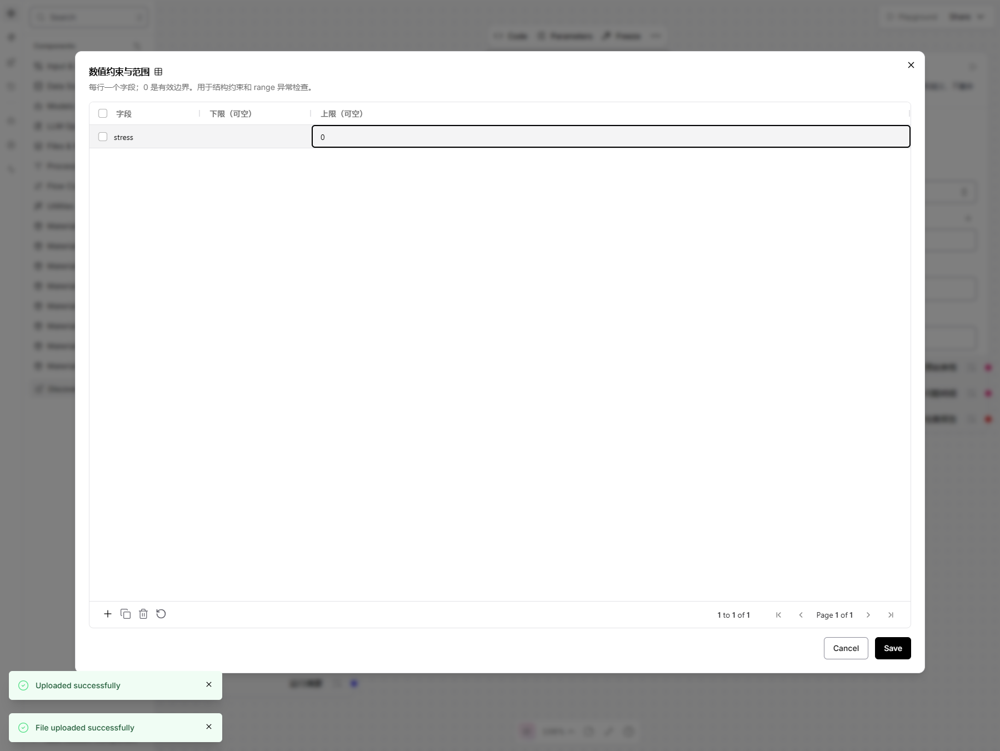

# 0.4.0 原生表单与端口验收

验收环境：Windows、Python 3.10、Langflow/LFX 1.13.0、真实 Microsoft Edge 无头浏览器。
浏览器使用独立的本机测试服务和新上下文，不依赖个人 skill、浏览器登录态或云端大模型。
0.4.0 保留 52 个正式节点，对 44 个科学操作及原有质量规则提供原生表单。

最终本地全套 **556 项测试通过**，156.22秒；7条提示均为第三方依赖弃用警告。Ruff通过。
九份工作流覆盖148条连接，回读57个文件并复核11个输入哈希。重启后的网页验收为
九份科学流程、三份原有质检流程、四项新手表单场景全部通过，未记录页面异常或失败API请求。

## 验收范围

| 检查 | 核对内容 |
|---|---|
| 全量自动测试 | 原有数值与数据边界、新控件、参数模式、序列化、任务分派、迁移和端口行为 |
| 九份科学工作流 | 重新生成后再导入执行，覆盖44个操作；核对合成真值、来源链、输入哈希和导出文件 |
| 九份科学流程网页运行 | 通过网页导入、核对节点及连线、点击运行、复制输出、打开HTML并解码图片 |
| 原有材料质检网页运行 | 正常0条、异常8条、人工修订0条；共享规则和追溯一致 |
| 新手上传与表单网页运行 | 实际选择文件、编辑列/单位/数值/列表/规则表，并运行查看输出；没有手写JSON |
| 普通wheel安装 | 独立环境安装0.4.0，发现52节点，执行五份原有流程及九份科学流程 |

最终机器可读结果见[验收记录](node-ui-acceptance.json)。完整运行日志、逐节点模板、截图和运行产物
保留在 `artifacts/`；GitHub Actions 上传两类测试作业的产物。

## 新手表单实际操作

1. 上传401行合成拉伸CSV，在界面选择 `strain`、`stress`、`fraction`、`MPa` 和弹性区间
   `0..0.0008`；得到 E=200000 MPa、屈服应力约202.01005 MPa。七条连线均保留，HTML曲线图片正常解码。
2. 上传13×7 PNG；图像导入没有表格端口，结果明确无表格，报告包含正确宽高。
3. 在共享规则的原生列表中填不存在的必需列，再打开规则表设置 `stress` 上限为0并保存；
   运行得到401条发现，其中一条缺列、400条超过约束。验证0作为有效边界保留。
4. 缺失处理方法切换为 `linear`，排序列与连续变量确认控件出现。
   此项验证动态显示；插值数值行为由领域自动测试覆盖。





## 最后复核修正

- 空数值不会被SDK默认0误解为用户设置；可选数值使用明确的自定义开关。
- RGB、矩形坐标、重复宽度、网格和转换器命令参数保留顺序及重复值。
- `form` 与 `json` 配置独立；旧JSON不注入新的表单默认值，制表符分隔符不会被裁掉。
- 连接中的可选追溯端口保持可见，导入网页后不丢连线；字段按任务顺序排列，区间先下限后上限。
- 模型任务选择决定训练、已有模型或已有预测值路径，记录到来源与缓存；旧JSON仍保留原自动分派。
- 原生单位检查默认只提供三个诊断输出，明确开启换算才显示第四个输出；受阻换算明确报错。
  当前节点的JSON兼容模式保留旧端口，无结果时标记缺失及原因，避免改变旧报告链。
- 迁移只识别固定来源哈希的正式节点；自定义代码不执行、不替换，旧参数不静默丢弃。
  浅克隆CI通过静态旧流程样本复核迁移，不依赖Git历史可用性。
- 上传回归覆盖“文件行先显示、上传回调稍后自动勾选”的异步时序；脚本通过原生复选框确认选中状态，
  只对已复现的勾选竞争作有限恢复，不绕过网页控件，也不重试整个计算任务。

独立复核已关闭可复现问题。没有宣称测试了每个方法的每一种真实实验输入。
列名候选仍受Langflow能否提供上游元数据限制，未提供时可以输入实际列名。

## 复现命令

在包目录、正确安装依赖的环境中运行：

```powershell
python -m pytest -q
python -m scripts.build_science_examples --verify-only
python -m build --wheel
# 普通安装wheel后，在该环境运行：
python -m scripts.verify_install --require-wheel
```

启动隔离Langflow后运行实际网页验收，以下端口须对应自己的测试服务：

```powershell
python -m scripts.ui_acceptance --base-url http://127.0.0.1:7867
python -m scripts.ui_science_acceptance --base-url http://127.0.0.1:7867
python -m scripts.ui_forms_acceptance --base-url http://127.0.0.1:7867
```

Windows使用系统Edge时可为三条命令添加
`--chrome-executable "C:\Program Files (x86)\Microsoft\Edge\Application\msedge.exe"`。
安装Playwright自带Chromium时不需要这个选项。
