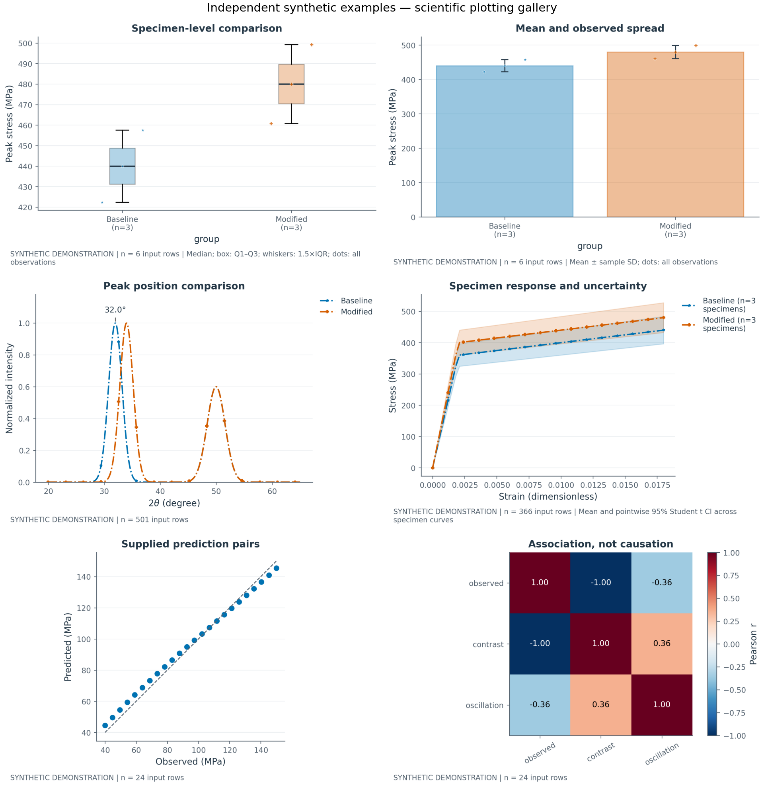

# 科研绘图示例

以下是六个独立的**合成数据演示**。它们展示绘图与导出能力，不是材料实验结论。
每幅图的原始点、汇总量、单位和样本数来自对应的数据与配置；颜色在不同图中保持对象身份。



| 示例 | 阅读重点 | 可复核文件 |
|---|---|---|
| [样品比较](01-box.png) | 箱线图叠加全部观测，显示每组 n | [四格式、图注、数据](01-box/) |
| [均值与波动](02-bars.png) | 样本 SD 与原始点；不以柱高推断显著性 | [四格式、图注、数据](02-bars/) |
| [谱峰比较](03-spectra.png) | 相同对象的颜色与标记，峰位标注留白 | [四格式、图注、数据](03-spectra/) |
| [应力—应变](04-mechanics.png) | 按试样计算的均值和逐点 95% Student t 区间 | [四格式、图注、数据](04-mechanics/) |
| [预测配对](05-prediction.png) | 同尺度坐标、单位和身份参考线；输入为提供的数值配对 | [四格式、图注、数据](05-prediction/) |
| [相关矩阵](06-correlation.png) | 固定 -1～1 的零中心色标，不将相关解释为因果 | [四格式、图注、数据](06-correlation/) |

每个目录包含 `figure.png / .svg / .pdf / .tiff / .json / .md` 以及 `source.csv`。
SVG/PDF 保留文字；TIFF 为 600 dpi；CSV 和 JSON 保留完整数值，图轴的小数位只是显示格式。
`gallery.json` 保存每例配置、相对路径和源文件 SHA-256。

在组件包目录重新生成：

```powershell
python -m scripts.render_paper_gallery --output artifacts/paper-figures
```

各图可以从 CSV 与配置重绘。精确浮点回读可使用 `pd.read_csv(path, float_precision="round_trip")`；
源单位由 `gallery.json` 中的配置恢复。项目代码不依赖个人 Skill 路径。

Langflow 节点的配置增加 `"profile":"paper"` 即可使用同一规格。
[详细参数与检查边界](../../docs/publication-plots.md)。
